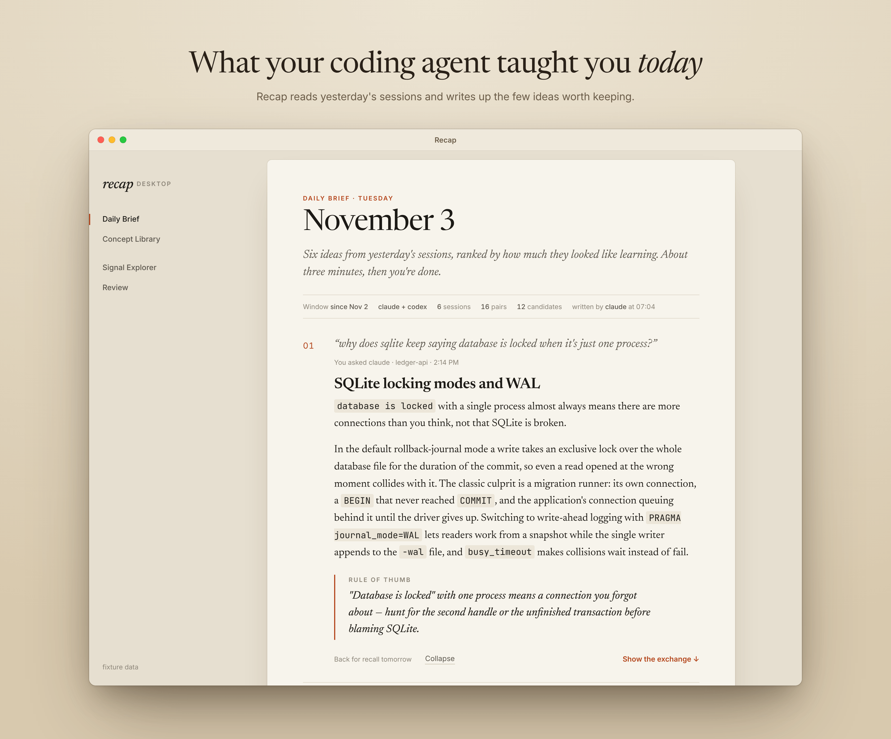
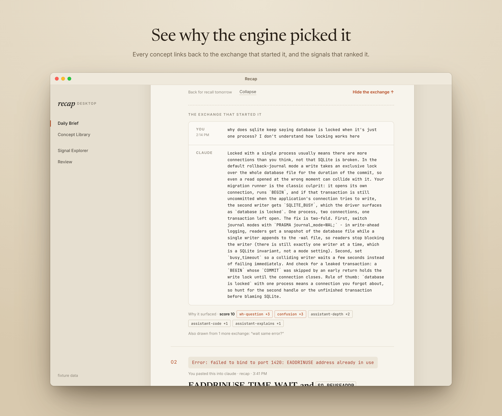
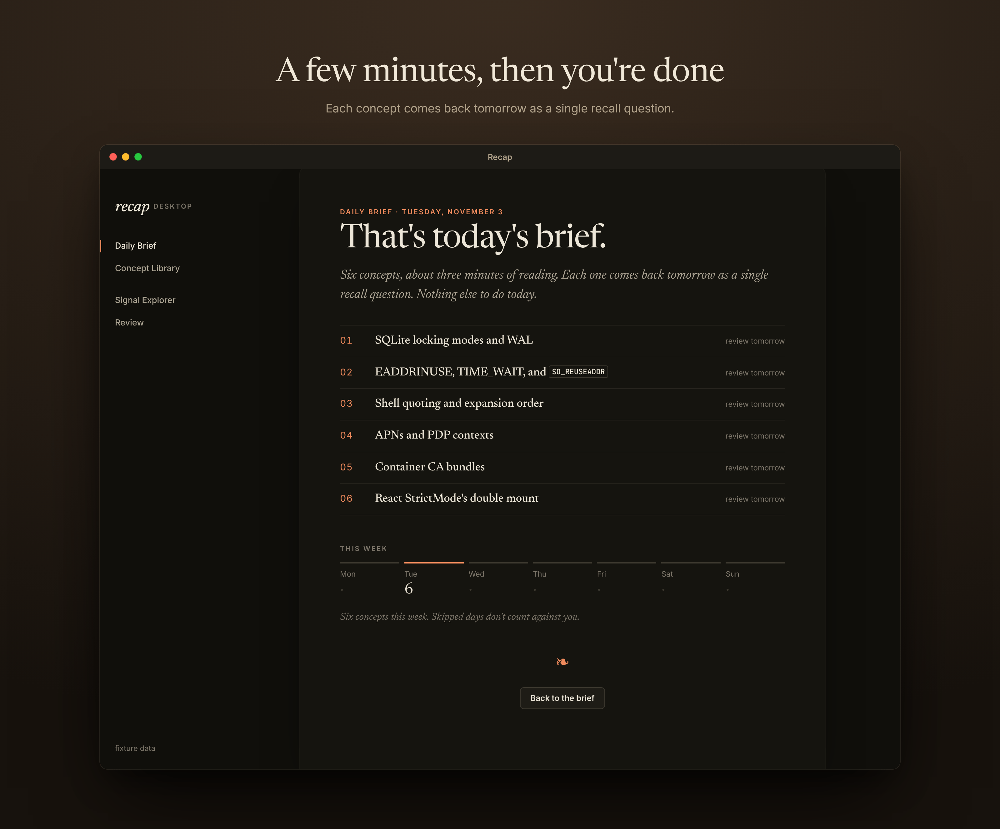

# recap

A daily knowledge-point briefing from your coding-agent sessions. Scans the prior N days of Claude Code and Codex transcripts on your machine, finds the moments where you encountered something unfamiliar, and produces a dense few-paragraph explainer of the underlying concepts — so you actually learn what the agent did instead of just merging the diff.



## Why

When you offload most of your coding to an AI agent, you stop reading what it produces. The first time it reaches for `AT+CGDCONT`, `ASWebAuthenticationSession`, or a quantized GGUF, you skim the explanation and move on. Six months in, you've shipped a lot and learned almost nothing — skill atrophy that compounds quietly.

`recap` is a counterweight. Every morning it pulls the prior day's sessions, picks the 4–6 highest-leverage things you brushed past, and writes them up as concept explainers — what the thing actually is, how it works, and the rule of thumb worth keeping. Not an activity log. Not a summary of what got done. Just the knowledge.

## Desktop app

[`desktop/`](desktop/) is a Tauri app that turns recap's output into a learning center you check in on, instead of a markdown file you scroll once.

- **Daily brief.** The day's concepts as cards. Each opens to the full explainer and its rule of thumb, then to the exchange that started it, with the signals and score that made the engine pick it.
- **Signal explorer.** Every candidate the engine scored, including the ones below the cut, with filters and the score arithmetic for each.
- **Spaced review.** Concepts come back as short recall questions: recall, reveal, grade. Kept ones come back less often, lost ones return tomorrow, and a skipped day just leaves the due list waiting.
- **Local-first.** The app runs the same Go engine as a bundled sidecar and keeps its data in a SQLite file on your machine. No account, no server.





To build and run it, see [desktop/README.md](desktop/README.md).

## How it works

```
~/.claude/projects/<slug>/<uuid>.jsonl     ┐
~/.codex/sessions/YYYY/MM/DD/rollout-*.jsonl ┘
              │
              ▼
   parse  →  pair (user_msg, whole assistant turn), redact secrets
              │
              ▼
   score  →  named signals, user side gates, assistant side amplifies
              (wh-question, reactive, confusion, error-paste,
               imperative/long/slash demotion, assistant depth)
              │
              ▼
   top N  →  dedup, pipe JSON + system prompt into `claude -p` or `codex exec -`
              │
              ▼
   stdout + ~/.claude/morning-recap/recap-YYYY-MM-DD.md
```

No API keys, no SDK dependencies. Inference goes through whichever official CLI you already use (`claude` or `codex`), so it inherits your auth, your model selection, and your billing.

## Install

Requires Go 1.22+, plus at least one of `claude` (Claude Code CLI) or `codex` (Codex CLI) on your `$PATH`.

```sh
git clone https://github.com/madebywelch/recap.git
cd recap
go test ./...
go build -o recap ./...
ln -s "$(pwd)/recap" ~/.local/bin/recap   # or any directory on $PATH
```

## Usage

```sh
recap                           # past 1 day, both tools, auto-pick inference CLI
recap --days 3                  # 3-day window
recap --since 2026-04-30        # absolute start date
recap --tool claude             # only mine Claude Code sessions
recap --tool codex              # only mine Codex sessions
recap --inference codex         # force Codex as the inference engine
recap --raw                     # skip inference, print the scan envelope (scored candidates, structured signals) as JSON
recap --top 50                  # send more candidates to inference (default 30)
recap --no-archive              # don't write the dated markdown file
recap --timeout 600             # raise inference timeout (default 240s)
```

### Cron / launchd

Run it every morning at 7am:

```cron
0 7 * * * /Users/you/.local/bin/recap --days 1 >/dev/null 2>&1
```

Then `cat ~/.claude/morning-recap/recap-$(date +%F).md` over coffee.

## Example output

Real run, `recap --days 3`, top of the file:

> **APN and AT+CGDCONT.** A cellular modem doesn't get IP data the moment a SIM slots in — it needs an APN (Access Point Name) string that names which carrier gateway to attach to (e.g., `hologram`, `internet`, `iot.t-mobile`). Configuring it means sending the AT command `AT+CGDCONT=1,"IP","hologram"\r` over the modem's UART/serial port — context ID 1, IPv4 PDP type, APN string — then activating the PDP context with `AT+CGACT=1,1` or dialing `*99#`. AT commands are the Hayes-era control protocol every cellular modem still speaks: write `AT+CMD?\r` to query, `AT+CMD=value\r` to set, expect `OK` or `ERROR`. Rule of thumb: if the carrier dashboard shows the SIM "connected" but the device can't reach the internet, the firmware likely registered on the network for SMS/voice without ever telling the modem the APN — a common omission in closed-source firmware blobs that "just work" on consumer SIMs but break on IoT carriers.
>
> **generate_204 connectivity probe.** `http://www.google.com/generate_204` and `http://connectivitycheck.gstatic.com/generate_204` are tiny endpoints that respond with HTTP 204 No Content and zero bytes — Android, ChromeOS, and embedded Linux hit them to detect captive portals…

A typical run produces 4–6 such entries. Each entry ends with a machine-readable `sources: id1,id2` line citing the transcript candidates it drew from — the ids come from the `--raw` JSON, so a concept card can link back to the exchange that triggered it.

### The engine is an importable package

The scan → parse → redact → score pipeline lives in [`engine/`](engine/), importable as `github.com/madebywelch/recap/engine` — the CLI is a thin layer over it, and the planned desktop app runs the same pipeline as a sidecar.

```go
res, err := engine.Collect(engine.Options{Days: 1, MinScore: -100})
for _, c := range res.Candidates {
    fmt.Println(c.ID, c.Score, c.UserScore, c.AssistantBonus, c.Signals)
}
```

`--raw` prints the JSON encoding of `engine.Result`. That shape is a versioned client contract, documented in [docs/engine-json.md](docs/engine-json.md), with a committed example fixture in [testdata/engine-v1.json](testdata/engine-v1.json) a UI can develop against without running the engine. Every candidate carries its full reasoning: a structured per-signal breakdown (name, signed weight, user/assistant side), the user-side and assistant-side sums, a stable id that survives rescans, and the redacted excerpts.

## Configuration

| Path | Purpose |
| --- | --- |
| `~/.claude/projects/*/*.jsonl` | Source: Claude Code session transcripts |
| `~/.codex/sessions/YYYY/MM/DD/*.jsonl` | Source: Codex session transcripts |
| `~/.claude/morning-recap/recap-YYYY-MM-DD.md` | Default archive directory (override with `--archive-dir`) |

There is no config file. Everything is a flag.

## What it filters out

Both transcript formats include a lot of machinery that isn't user input. `recap` drops:

- Tool-call results (Claude masquerades these as `type: "user"` lines)
- Sidechains and meta-injected messages (`isSidechain`, `isMeta`)
- System-instruction wrappers (Conductor, hooks, slash-command markers)
- Bash stdout/stderr blocks, task notifications, environment-context blocks
- Codex's auto-injected env/permissions turns
- Slash commands like `/agents` or `/skill foo` (scored down)
- Session-continuation summary blocks that ride along when context fills
- `[Request interrupted by user]` markers and Codex plugin/app-page injections
- Duplicate prompts replayed by forked worktrees or resumed sessions (kept once)

What's left is the actual back-and-forth between you and the agent, scored for moments that read like genuine confusion or curiosity.

## How scoring works

A pair is one user message plus every assistant text block before the next user message. Both CLIs write one record per content block, so the turn is reassembled from interleaved thinking, text, tool_use and tool_result records.

The user side decides whether a pair is a learning moment; the assistant side can at most double it, never create it. An imperative answered with a long summary is a completed task, not a lesson.

| Signal | Weight | Fires on |
| --- | --- | --- |
| `reactive` | +4 | Whole message is a reaction: `wait`, `huh?`, `what block?` |
| `wh-question` | +3 | A sentence opening with what/why/how/explain/tell me about; where/when/which need a `?` |
| `confusion` | +3 | "I don't understand", "not sure how", "what do you mean", "wtf" |
| `error-paste` | +2 | Tracebacks, `error:`, `ECONNREFUSED`, `"type":"error"`, `failed:` |
| `question` | +1 | Any other sentence ending in `?`, including "how about X" |
| `imperative` | -1 | First sentence opens with fix/deploy/merge/build/... |
| `ui-feedback` | -1 | Contains an `[Image #N]` reference |
| `long` | -1 / -2 | Over 60 / 150 words (specs, dictations, pasted emails) |
| `slash-command` | -3 | `/agents`, `/skill foo`; paths like `/Users/...` do not match |
| `assistant-depth` | +1 / +2 | Reply is 80 / 200+ words |
| `assistant-code` | +1 | Reply contains code spans |
| `assistant-explains` | +1 | Reply uses "because", "which means", "under the hood", ... |
| `assistant-thin` | -1 | Reply under 15 words |
| `assistant-cap` | -N | Clamps the assistant bonus to the user score |

`--raw` prints the full reasoning next to each score — every signal with its side and weight, the user/assistant split, and the total — so a surprising rank is diagnosable in one look (schema: [docs/engine-json.md](docs/engine-json.md)). To recalibrate, dump a week with `recap --raw --days 7 --min-score -100 --top 0` and read the band around `--min-score`.

## Privacy

Sessions never leave your machine *except* via the inference CLI you select. `recap` itself makes no network calls. The scored candidates are piped over stdin to `claude -p` or `codex exec -`, which then send the request through their normal API path under your account. If you don't want session contents going through a hosted model, run `--raw` and read the candidate JSON yourself.

API keys pasted into sessions are replaced with `[REDACTED]` before anything leaves the parser: Stripe/OpenAI/Anthropic-style `sk_`/`pk_` keys, GitHub, Slack, AWS and Google tokens, JWTs, bearer headers, `key: <value>` forms, private key blocks and long hex blobs. Treat it as a seatbelt, not a guarantee; `redact.go` lists the patterns.

The archive directory is a plain markdown file. Nothing is uploaded.

## Limitations

- Heuristics are surface-level on purpose. They read sentence openers, a few confusion phrases and error shapes, and the size of the reply. Confusion phrased as a confident statement is missed; a yes/no status question with a long answer scores a weak 2 and relies on the model to discard it.
- Both source formats are undocumented internals of their respective CLIs and may change. The parser tolerates unknown fields, but a major schema break would need a fix.
- Claude session files can grow large (multi-MB transcripts). Scanning 60+ sessions with `--days 7` is still sub-second; the bottleneck is always the inference call.
- The recap is only as good as the source material. A day spent purely typing slash commands and accepting suggestions produces a thin recap. That's correct behavior, not a bug.

## Project layout

```
main.go        flag parsing, orchestration, stderr phase events, archive
inference.go   shell out to claude/codex via stdin
prompt.go      the system prompt sent to the inference CLI
engine/        the importable pipeline package (engine.Collect / engine.Score)
  engine.go    Options, scan envelope, version, public API
  scan.go      date-windowed walk of session directories
  parse.go     JSONL parsers for both formats; turn pairing; system-injection filters
  redact.go    secret patterns applied to every pair
  score.go     named-signal heuristics, stable candidate ids, dedup, ranking
  *_test.go    fixtures for pairing, scoring, and the JSON contract
docs/          engine JSON schema (docs/engine-json.md)
testdata/      committed schema fixture (engine-v1.json)
```

Single Go binary, stdlib only. `go test ./...` runs in well under a second.

## License

MIT. See `LICENSE`.
